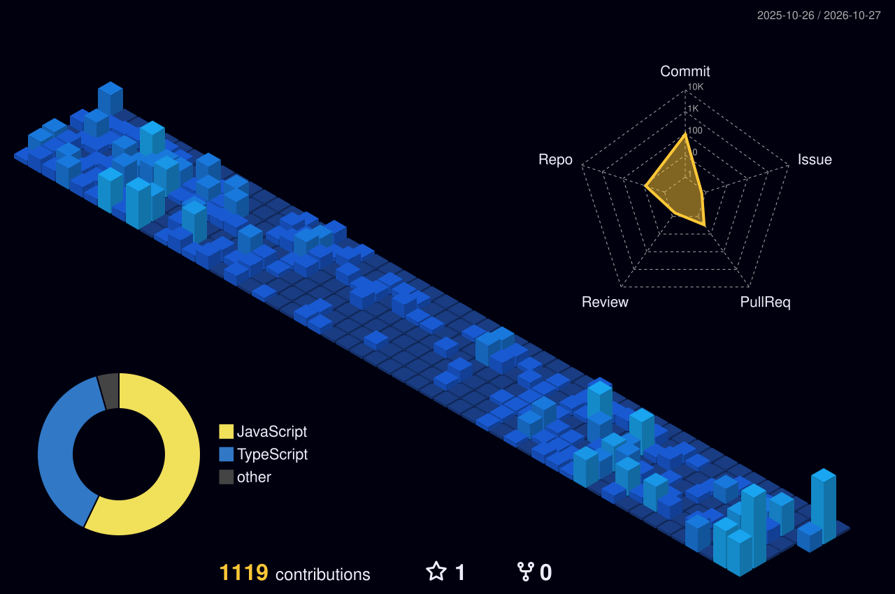

<!-- ───────────────────────────── Header ───────────────────────────── -->
<p align="center">
  
</p>

<p align="center">
  
</p>

<p align="center">
  <a href="https://www.linkedin.com/in/anuragmishra26"></a>
  <a href="https://instagram.com/mishra__anurag_"></a>
  <a href="https://codepen.io/gctputxl-the-lessful"></a>
  <a href="mailto:anuragmishra262000@gmail.com"></a>
  
</p>

<br />

<!-- ───────────────────────────── About ───────────────────────────── -->
## 👋 About me

```ts
const anurag = {
  role:      "Full Stack Web Developer",
  focus:     ["Elegant, responsive UIs", "Reliable APIs", "Clean architecture"],
  frontend:  ["Next.js", "React", "TypeScript", "Tailwind CSS", "SCSS", "Redux"],
  backend:   ["Node.js", "Express", "REST", "GraphQL"],
  data:      ["PostgreSQL", "MongoDB", "Firebase", "Supabase", "Appwrite"],
  learning:  ["Docker", "CI/CD", "Databases", "System design"],
  openTo:    "Work opportunities & exciting projects",
};
```

- 🔭 Building a self-hosted **project & time-tracking tool** for small teams with Next.js, PostgreSQL and Drizzle
- 🌱 Using it to learn **production engineering**: Docker, CI/CD, databases and architecture
- 💬 Ask me about **React, Next.js, TypeScript and full-stack web apps**
- ⚡ I care about clean code, fast pages and interfaces that feel good to use

<br />

<!-- ───────────────────────────── Tech stack ───────────────────────────── -->
## 🛠️ Tech stack

<table align="center">
  <tr>
    <td align="center" width="140"><b>Frontend</b></td>
    <td></td>
  </tr>
  <tr>
    <td align="center"><b>Backend</b></td>
    <td></td>
  </tr>
  <tr>
    <td align="center"><b>Data &amp; BaaS</b></td>
    <td></td>
  </tr>
  <tr>
    <td align="center"><b>DevOps &amp; tools</b></td>
    <td></td>
  </tr>
</table>

<br />

<!-- ───────────────────────────── 3D contributions ───────────────────────────── -->
## 🏙️ My contributions, in 3D

<p align="center">
  <picture>
    <source media="(prefers-color-scheme: dark)" srcset="./profile-3d-contrib/profile-night-view.svg" />
    <source media="(prefers-color-scheme: light)" srcset="./profile-3d-contrib/profile-green-animate.svg" />
    
  </picture>
</p>

<!-- ───────────────────────────── Stats ───────────────────────────── -->
## 📊 GitHub stats

<p align="center">
  <picture>
    <source media="(prefers-color-scheme: dark)" srcset="https://github-readme-stats.vercel.app/api?username=anurag262000&show_icons=true&include_all_commits=true&count_private=true&theme=tokyonight&bg_color=0D1117&hide_border=true&title_color=38BDF8&icon_color=38BDF8" />
    
  </picture>
  <picture>
    <source media="(prefers-color-scheme: dark)" srcset="https://github-readme-stats.vercel.app/api/top-langs/?username=anurag262000&layout=compact&count_private=true&theme=tokyonight&bg_color=0D1117&hide_border=true&title_color=38BDF8" />
    
  </picture>
</p>

<p align="center">
  <picture>
    <source media="(prefers-color-scheme: dark)" srcset="https://streak-stats.demolab.com/?user=anurag262000&theme=tokyonight&background=0D1117&hide_border=true&ring=38BDF8&fire=38BDF8&currStreakLabel=38BDF8" />
    
  </picture>
</p>

<br />

<!-- ───────────────────────────── Footer ───────────────────────────── -->
<p align="center">
  <b>Open to work opportunities and exciting projects. Let's build something great together. 🚀</b>
</p>

<p align="center">
  
</p>
